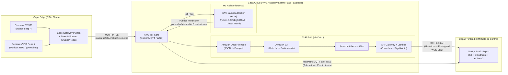

# AGENTS.md — Arquitectura y Guía Operativa para Agentes (Google Antigravity)

> **Proyecto:** Sistema Híbrido de Telemetría y Mantenimiento Predictivo Industrial (OT/IT + AWS Cloud)  
> **Activo Crítico:** Molino Coloidal de Emulsiones Asfálticas — *Química Latinoamericana*  
> **Entorno Cloud:** AWS Academy Learner Lab (Restricción estricta a `LabRole`)

---

## 1. Mapa de Arquitectura del Sistema

El sistema opera bajo un paradigma **Edge-to-Cloud con arquitectura Tri-Ruta (Hot, Cold y ML Path)** para captura no invasiva en planta (OT), almacenamiento analítico (IT), inferencia predictiva multivariante y visualización en tiempo real (HMI).



---

## 2. Estructura del Repositorio

```text
PortafolioTitulo/
├── AGENTS.md                           # Este documento maestro de arquitectura y contratos
├── .antigravity/
│   ├── rules.md                        # Reglas inquebrantables del proyecto (IAM, Static Export, Contratos)
│   └── skills/
│       ├── iot-data-contract/          # Sincronización de payloads OT -> Athena -> ML -> HMI
│       ├── learner-lab-serverless/     # Despliegue con LabRole, ECR Python 3.12 y SigV4 WSS
│       └── hmi-echarts-streaming/      # UI Industrial Dark, MQTT WSS Hook y ECharts alta frecuencia
├── edge-gateway/                       # Adquisición OT y resiliencia local
│   ├── src/
│   │   ├── collectors/
│   │   │   ├── s7_collector.py         # Lectura no invasiva DBs Siemens S7-300 (python-snap7)
│   │   │   └── modbus_collector.py     # Lectura RS-485 Modbus RTU (pymodbus)
│   │   ├── buffer/
│   │   │   └── store_and_forward.py    # Cola transaccional SQLite/Redis ante caídas de red
│   │   ├── publisher/
│   │   │   └── mqtt_mtls_client.py     # Cliente AWS IoT Core (awscrt / paho-mqtt)
│   │   ├── simulator/
│   │   │   └── mock_mill_publisher.py  # Simulador físico-químico del molino e inyección de fallas
│   │   └── models/
│   │       └── telemetry_schema.py     # Validación Pydantic del contrato de telemetría
│   └── tests/
├── cloud-infra/                        # Infraestructura y Lambdas auxiliares (Learner Lab compatible)
│   ├── scripts/
│   │   ├── deploy_all.sh               # Script de despliegue usando LabRole dinámicamente vía STS
│   │   └── setup_athena_glue.sql       # DDL de tablas particionadas Parquet en Glue/Athena
│   └── lambdas/
│       ├── iot_sigv4_signer/           # Genera Pre-signed WSS URL con X-Amz-Security-Token (LabRole)
│       └── historical_query_api/       # Consulta Athena y retorna series históricas al HMI
├── ml-lambda-ecr/                      # Motor de Mantenimiento Predictivo en Contenedor Docker
│   ├── Dockerfile                      # Basado en public.ecr.aws/lambda/python:3.12
│   ├── requirements.txt                # lightgbm, scikit-learn, numpy, pandas, onnxruntime
│   ├── artifacts/                      # Modelos serializados (.txt/.onnx) y escaladores
│   ├── src/
│   │   ├── handler.py                  # Entrypoint Lambda (Warm Start de modelos en memoria global)
│   │   ├── feature_engineering.py      # Cruce Estado x Tipo de Asfalto, ventanas móviles y desgaste
│   │   ├── lgbm_frequent_faults.py     # Clasificación/Regresión LightGBM (sobrecarga, filtro, radar)
│   │   └── linear_rare_faults.py       # Proyección lineal (cortocircuito, Pt100, intercambiador, rodamientos)
│   └── tests/
└── hmi-frontend/                       # Dashboard Industrial Next.js (Static Export)
    ├── next.config.mjs                 # Configurado obligatoriamente con output: 'export'
    ├── src/
    │   ├── types/
    │   │   └── telemetry.ts            # Interfaces TypeScript sincronizadas con OT y ML
    │   ├── hooks/
    │   │   └── useIoTMqttStream.ts     # Gestión WebSocket MQTT + auto-refresh de URL SigV4 STS
    │   ├── components/
    │   │   ├── charts/                 # Wrappers Apache ECharts con buffer circular y throttling
    │   │   └── alerts/                 # Semáforos de horizonte predictivo (24h, 5d, 15d)
    │   └── app/                        # Vistas de Sala de Control (Dark Mode Industrial)
    └── package.json
```

---

## 3. Guía Operativa para Agentes de Antigravity

### 3.1. File Agent (Edición y Sincronización de Código)
- **Regla de Propagación en Cadena:** Si agregas, renombras o modificas una variable física del molino coloidal o del resultado de inferencia, **DEBES** activar y seguir la skill `.antigravity/skills/iot-data-contract/SKILL.md` para actualizar en el mismo turno los 4 puntos del sistema (`edge-gateway`, `cloud-infra`, `ml-lambda-ecr` y `hmi-frontend`).
- **Validación de Configuración Frontend:** Antes de concluir cambios en `hmi-frontend/`, verifica que `next.config.mjs` mantenga `output: 'export'` y `images: { unoptimized: true }`. No crees rutas en `app/api/` ni uses `getServerSideProps` o Server Actions.

### 3.2. Terminal Agent (Pruebas, Simuladores y Build)
Ejecuta siempre los comandos desde el directorio correspondiente verificando el entorno virtual o paquetes locales:

1. **Pruebas Unitarias en Edge Gateway y Motor ML (Python 3.12):**
   ```powershell
   # Validar esquemas, Store-and-Forward y colectores OT (con mocks de snap7/pymodbus)
   pytest edge-gateway/tests -v

   # Validar ingeniería de características, inferencia LightGBM y proyecciones lineales (24h/5d/15d)
   pytest ml-lambda-ecr/tests -v
   ```

2. **Levantar Simulador MQTT Local (Pruebas End-to-End sin PLC físico):**
   ```powershell
   # 1. Levantar broker Mosquitto local (con soporte MQTT 1883 y WebSockets 9001)
   docker run -d --name mosquitto-dev -p 1883:1883 -p 9001:9001 eclipse-mosquitto:2 mosquitto -c /mosquitto-no-auth.conf

   # 2. Ejecutar simulador de telemetría del molino coloidal e inyector de anomalías
   python edge-gateway/src/simulator/mock_mill_publisher.py --broker localhost --port 1883 --interval-ms 250 --mode normal
   ```
   *Modos soportados por el simulador:* `normal`, `overload_vfd`, `clogged_filter`, `bearing_wear`, `pt100_drift`.

3. **Compilación y Verificación de Exportación Estática del HMI (Next.js):**
   ```powershell
   cd hmi-frontend
   npm run lint
   npm run build
   # Verificar que la carpeta 'out/' haya sido generada exitosamente sin errores de SSR
   ```

### 3.3. Browser Agent (Verificación Visual y Rendimiento del HMI)
Cuando se solicite verificar el HMI en `http://localhost:3000` (o sirviendo la carpeta estática `out/`):
1. **Inspección de Consola y Red:** Comprobar con DevTools que la conexión WebSocket (`wss://...` hacia AWS IoT Core o `ws://localhost:9001` en modo local) alcance el estado `101 Switching Protocols` y no arroje errores `403 Forbidden` por firma SigV4 inválida o token STS omitido.
2. **Estabilidad de Frame Rate (FPS) y Memoria:** Verificar que al recibir ráfagas de telemetría (250 ms) las gráficas de **Apache ECharts** actualicen de forma fluida sin causar re-renders masivos del árbol React ni fugas de memoria (Memory Leaks).
3. **Validación de Semáforos Predictivos:** Confirmar que los paneles de horizontes **24h, 5d y 15d** reflejen el código cromático industrial (`NORMAL` verde esmeralda, `WARNING` ámbar, `CRITICAL` rojo alarma) acorde al payload del tópico `planta/asfalto/molino/predicciones`.

---

## 4. Contrato de Datos JSON (Tópicos MQTT)

### 4.1. Tópico de Ingesta: `planta/asfalto/molino/telemetria` (Contrato Canónico de 31 Variables)
Publicado por el **Edge Gateway** (`edge_gateway/simulador_edge.py` / `simular_telemetria_continua.py`). Alimenta el **Hot Path** (HMI directo), **Cold Path** (Firehose -> S3 Parquet `glue_table.json`) y **ML Path** (`lambda_inferencia`). Contiene los metadatos de paquete más las **31 variables canónicas de entrada** (`29 sensores float` + `2 binarias int`) que consumen los Modelos 1, 2 y 3:

| # | Campo JSON (Tag QLA) | Tipo | Unidad Física | Subsistema OT | Rango Nominal (`Produccion`) | Rol en Pipeline ML (`31 -> 11 -> 80`) |
| :- | :--- | :--- | :--- | :--- | :--- | :--- |
| — | `timestamp` | `string` (ISO-8601) | UTC (`Z`) | Gateway RTC / NTP | — | Marca temporal para ventanas móviles (`24h`, `72h`, `168h`) y calendario. |
| — | `equipo_id` | `string` | — | Config Gateway | `"MOLINO_01"` | Identificador único del activo en planta. |
| — | `ESTADO_operacion` | `string` (Enum) | — | PLC S7-300 (`DB10`) | `"Produccion"` \| `"Limpieza"` \| `"Detenido"` | Define el régimen operativo y deriva `en_limpieza`. |
| — | `TIPO_asfalto` | `string` (Enum) | — | PLC S7-300 (`DB10`) | `"Convencional"` \| `"Plastomerico"` | Define la receta en curso y deriva `es_plastomerico`. |
| **01** | `TEM_son_betum_in` | `float` (`double`) | `°C` | Circuito Betún | `140.0` – `155.0` | **31 (M1/M2)** + **11 Base M3** (`dev_TEM_son_betum_in` y `picos_TEM`). |
| **02** | `RES_son_betum_in` | `float` (`double`) | `Ω` | Circuito Betún | `150.0` – `162.0` | **31 (M1/M2)** — Diagnóstico eléctrico RTD betún. |
| **03** | `VOLT_son_betum_in` | `float` (`double`) | `V` | Circuito Betún | `3.10` – `3.45` | **31 (M1/M2)** + **11 Base M3** (`dev_VOLT_son_betum_in` y `dev_VOLT_min` para Pt100). |
| **04** | `AMP_son_betum_in` | `float` (`double`) | `mA` | Circuito Betún | `12.0` – `15.5` | **31 (M1/M2)** — Lazo 4–20 mA sonda betún. |
| **05** | `AMP_cau_betum_in` | `float` (`double`) | `mA` | Circuito Betún | `11.0` – `14.5` | **31 (M1/M2)** — Lazo 4–20 mA caudalímetro betún. |
| **06** | `FRE_cau_betum_in` | `float` (`double`) | `Hz` | Circuito Betún | `480.0` – `560.0` | **31 (M1/M2)** — Frecuencia pulsos caudalímetro betún. |
| **07** | `AMP_eco_betum_dep` | `float` (`double`) | `dB` | Circuito Betún (Radar) | `45.0` – `65.0` | **31 (M1/M2)** + **11 Base M3** (`dev_AMP_eco_betum_dep` — degradación de eco/espuma). |
| **08** | `EST_niv_betum_dep` | `float` (`double`) | `NAMUR (0/1/2)` | Circuito Betún (Radar) | `0.0` (`0`=OK, `1`=Adv, `2`=Falla) | **31 (M1/M2)** + **11 Base M3** (`EST_radar` — estado diagnóstico radar). |
| **09** | `TEM_son_solucion_in` | `float` (`double`) | `°C` | Circuito Solución | `50.0` – `62.0` | **31 (M1/M2)** — Temperatura fase acuosa/jabonosa. |
| **10** | `RES_son_solucion_in` | `float` (`double`) | `Ω` | Circuito Solución | `119.0` – `125.0` | **31 (M1/M2)** — Resistencia RTD solución. |
| **11** | `AMP_son_solucion_in` | `float` (`double`) | `mA` | Circuito Solución | `8.5` – `10.5` | **31 (M1/M2)** — Lazo 4–20 mA temperatura solución. |
| **12** | `AMP_cau_solucion_in` | `float` (`double`) | `mA` | Circuito Solución | `12.5` – `15.5` | **31 (M1/M2)** + **11 Base M3** (`dev_AMP_cau_solucion_in` — deriva caudalímetro). |
| **13** | `FRE_cau_solucion_in` | `float` (`double`) | `Hz` | Circuito Solución | `600.0` – `700.0` | **31 (M1/M2)** — Frecuencia pulsos caudalímetro solución. |
| **14** | `AMP_eco_solucion_dep` | `float` (`double`) | `dB` | Circuito Solución | `48.0` – `65.0` | **31 (M1/M2)** — Eco radar estanque solución. |
| **15** | `TEM_son_emulsion_out` | `float` (`double`) | `°C` | Circuito Emulsión | `85.0` – `96.0` | **31 (M1/M2)** — Temperatura sonda salida emulsión. |
| **16** | `RES_son_emulsion_out` | `float` (`double`) | `Ω` | Circuito Emulsión | `132.0` – `138.0` | **31 (M1/M2)** — Resistencia RTD salida emulsión. |
| **17** | `AMP_cau_emulsion_out` | `float` (`double`) | `mA` | Circuito Emulsión | `15.0` – `18.0` | **31 (M1/M2)** — Corriente caudalímetro emulsión. |
| **18** | `FRE_cau_emulsion_out` | `float` (`double`) | `Hz` | Circuito Emulsión | `800.0` – `920.0` | **31 (M1/M2)** — Frecuencia caudalímetro emulsión. |
| **19** | `AMP_eco_emulsion_dep` | `float` (`double`) | `dB` | Circuito Emulsión | `48.0` – `65.0` | **31 (M1/M2)** — Eco radar estanque emulsión. |
| **20** | `RPM_motor_molino` | `float` (`double`) | `RPM` | Motor / VFD Molino | `2850.0` – `2980.0` | **31 (M1/M2)** — Velocidad de giro rotor molino coloidal. |
| **21** | `FRE_vfd_motor_molino` | `float` (`double`) | `Hz` | Motor / VFD Molino | `48.0` – `50.5` | **31 (M1/M2)** — Frecuencia eléctrica salida VFD. |
| **22** | `AMP_vfd_motor_molino` | `float` (`double`) | `A` | Motor / VFD Molino | `55.0` – `78.0` | **31 (M1/M2)** + **11 Base M3** (`dev_AMP_vfd_motor_molino` — sobrecarga/cortocircuito). |
| **23** | `TOR_vfd_motor_molino` | `float` (`double`) | `%` | Motor / VFD Molino | `60.0` – `88.0` | **31 (M1/M2)** + **11 Base M3** (`dev_TOR_vfd_motor_molino` — carga mecánica). |
| **24** | `VIB_vel_motor_molino` | `float` (`double`) | `mm/s` (RMS) | Vibración Molino | `1.5` – `3.2` (ISO 10816) | **31 (M1/M2)** + **11 Base M3** (`dev_VIB_vel_motor_molino` — desgaste rodamientos). |
| **25** | `AMP_vib_motor_molino` | `float` (`double`) | `mA` | Vibración Molino | `6.8` – `9.5` | **31 (M1/M2)** — Lazo 4–20 mA transmisor de vibración. |
| **26** | `CAU_bomba_lpm` | `float` (`double`) | `L/min` | Hidráulica / Proceso | `140.0` – `190.0` | **31 (M1/M2)** + **11 Base M3** (`dev_CAU_bomba_lpm` y cálculo de `litros_24h`). |
| **27** | `PRE_dif_filtro_bar` | `float` (`double`) | `bar` | Hidráulica / Filtro | `0.30` – `0.75` | **31 (M1/M2)** + **11 Base M3** (`dev_PRE_dif_filtro_bar` — taponamiento filtro). |
| **28** | `TEM_emulsion_molino_out` | `float` (`double`) | `°C` | Térmica / Descarga | `88.0` – `98.0` | **31 (M1/M2)** — Temperatura descarga directa cabezal molino. |
| **29** | `PRE_intercambiador_bar` | `float` (`double`) | `bar` | Hidráulica / Térmica | `1.80` – `2.50` | **31 (M1/M2)** + **11 Base M3** (`dev_PRE_intercambiador_bar` — fouling intercambiador). |
| **30** | `es_plastomerico` | `int` (`0` \| `1`) | Binario | Derivada (`TIPO_asfalto`) | `1` si `"Plastomerico"`, `0` si `"Convencional"` | **31 (M1/M2)** + **M3** (acumulador `min_plasto_desde_intercambiador` y selector `ESTADO\|TIPO`). |
| **31** | `en_limpieza` | `int` (`0` \| `1`) | Binario | Derivada (`ESTADO_operacion`) | `1` si `"Limpieza"`, `0` en otro caso | **31 (M1/M2)** + **M3** (selector de referencia `ESTADO\|TIPO` y filtro de horas de marcha). |

---

### 4.2. Tópico de Alertas e Inferencia: `planta/asfalto/molino/predicciones`
Publicado por la **Lambda Docker de Inferencia (`ml-lambda-ecr`)** tras evaluar cada ventana de telemetría. Consumido en vivo por el **HMI Frontend** vía MQTT sobre WebSockets.

| Campo JSON (Path) | Tipo | Unidad Física | Motor / Modelo | Valores / Rango | Descripción Técnica |
| :--- | :--- | :--- | :--- | :--- | :--- |
| `timestamp` | `string` (ISO-8601) | UTC (`Z`) | Lambda Runtime | — | Instante de generación del pronóstico. |
| `source_telemetry_ts` | `string` (ISO-8601) | UTC (`Z`) | Payload Entrada | — | Timestamp del paquete de telemetría que disparó la inferencia. |
| `mill_id` | `string` | — | Payload Entrada | `"MOLINO-COLOIDAL-01"` | Identificador del molino evaluado. |
| `context_matrix_key` | `string` | — | Feature Eng. | Ej: `"STEADY_PRODUCTION__MODIFIED_POLYMER"` | Clave compuesta (`Estado × Tipo de Asfalto`) usada para normalizar residuales. |
| `overall_health_score` | `float` | `%` | Ensemble Aggregator | `0.0` – `100.0` | Índice global de salud operacional del activo (`100%` = óptimo). |
| `anomaly_detected` | `boolean` | — | Isolation / Z-Score Contextual | `true` / `false` | Indica desviación estadística inmediata respecto al régimen (`Estado × Tipo de Asfalto`). |
| `cumulative_wear_index` | `float` | `adimensional` | Integrador Desgaste | `>= 0.0` | Índice de fatiga acumulada ponderada por horas de torque alto, temperatura y vibración triaxial. |
| `horizons.h_24h.severity` | `string` (Enum) | — | Regla + ML (24 horas) | `"NORMAL"` \| `"WARNING"` \| `"CRITICAL"` | Nivel de alerta de corto plazo (acción inmediata en turno actual). |
| `horizons.h_24h.max_failure_prob` | `float` | `probabilidad` | LightGBM / Linear | `0.000` – `1.000` | Probabilidad máxima estimada de falla dentro de las próximas **24 horas**. |
| `horizons.h_24h.dominant_fault_code` | `string` (Enum) | — | Argmax Fault | Ver tabla de modos de falla | Código del modo de falla dominante en el horizonte de **24 horas**. |
| `horizons.h_5d.severity` | `string` (Enum) | — | Regla + ML (5 días) | `"NORMAL"` \| `"WARNING"` \| `"CRITICAL"` | Nivel de alerta de mediano plazo (planificación de parada semanal). |
| `horizons.h_5d.max_failure_prob` | `float` | `probabilidad` | LightGBM / Linear | `0.000` – `1.000` | Probabilidad máxima estimada de falla dentro de los próximos **5 días (120 h)**. |
| `horizons.h_5d.dominant_fault_code` | `string` (Enum) | — | Argmax Fault | Ver tabla de modos de falla | Código del modo de falla dominante en el horizonte de **5 días**. |
| `horizons.h_15d.severity` | `string` (Enum) | — | Regla + ML (15 días) | `"NORMAL"` \| `"WARNING"` \| `"CRITICAL"` | Nivel de alerta de largo plazo (gestión de repuestos y mantenimiento programado). |
| `horizons.h_15d.max_failure_prob` | `float` | `probabilidad` | LightGBM / Linear | `0.000` – `1.000` | Probabilidad máxima estimada de falla dentro de los próximos **15 días (360 h)**. |
| `horizons.h_15d.dominant_fault_code` | `string` (Enum) | — | Argmax Fault | Ver tabla de modos de falla | Código del modo de falla dominante en el horizonte de **15 días**. |
| `fault_breakdown.<FAULT_CODE>.engine` | `string` (Enum) | — | Router ML | `"LIGHTGBM"` \| `"LINEAR_TREND"` | Arquitectura utilizada según frecuencia histórica del modo de falla. |
| `fault_breakdown.<FAULT_CODE>.prob_24h` | `float` | `probabilidad` | Inferencia | `0.000` – `1.000` | Probabilidad específica del modo de falla a 24 horas. |
| `fault_breakdown.<FAULT_CODE>.prob_5d` | `float` | `probabilidad` | Inferencia | `0.000` – `1.000` | Probabilidad específica del modo de falla a 5 días. |
| `fault_breakdown.<FAULT_CODE>.prob_15d` | `float` | `probabilidad` | Inferencia | `0.000` – `1.000` | Probabilidad específica del modo de falla a 15 días. |
| `fault_breakdown.<FAULT_CODE>.estimated_ttf_hours` | `float` \| `null` | `horas (h)` | Regresión / Pendiente | `> 0.0` o `null` | Tiempo estimado hasta alcanzar el umbral crítico (Time-To-Failure) si la pendiente es positiva. |
| `recommended_action` | `string` | — | Prescriptive Engine | Texto técnico | Recomendación operativa concreta para el operador de sala de control o jefe de mantención. |

#### Flujo Canónico de Variables hacia los 3 Modelos (`31 -> 11 -> 80`)
- **Entrada Unificada (31 Variables):** Todo paquete que ingresa al motor de inferencia (`MolinoInferenceEngine.Normalizar_Entrada_31`) se estandariza a las **31 variables de entrada** (`29 sensores físicos` + `es_plastomerico` + `en_limpieza`).
  - **Modelo 1 (Diagnóstico Jerárquico LightGBM Etapa 1 y 2):** Consume directamente las **31 variables** escaladas.
  - **Modelo 2 (Vigilancia Autoencoder Keras):** Consume directamente las **31 variables** escaladas.
  - **Modelo 3 (Predicción Multi-Horizonte 24h / 5d / 15d):** Toma las mismas **31 variables de entrada**, las refactoriza primero a las **11 variables clave de degradación** (`10 sensores de desviación por modo` + `EST_niv_betum_dep` como `EST_radar`) y luego construye las **80 variables tabulares** (`65 de tendencias móviles 24h/72h/168h` + `10 de desgaste acumulado desde última mantención` + `litros_24h` + `4 de calendario`) **antes** de ejecutar las predicciones.

#### Códigos Estandarizados de Modos de Falla (`<FAULT_CODE>`)
1. **Fallas Frecuentes (Motor `LIGHTGBM`):**
   - `VFD_OVERLOAD`: Sobrecarga mecánica/eléctrica en motor del molino (`vfd_current_a`, `vfd_torque_pct`, caudal de bomba y tipo de asfalto).
   - `LINE_FILTER_CLOGGING`: Colmatación progresiva del filtro de línea (`line_filter_pressure_bar` vs `pump_flow_lpm`).
   - `RADAR_SIGNAL_DEGRADATION`: Pérdida de eco o espuma severa en radar de nivel (`radar_echo_db` vs `radar_level_pct`).
2. **Fallas Raras / Degradación Lenta (Motor `LINEAR_TREND` sobre ventanas móviles y desgaste):**
   - `ELECTRICAL_SHORT_CIRCUIT`: Anomalía de aislamiento o desbalance abrupto en devanados/VFD.
   - `PT100_SENSOR_DRIFT`: Deriva termoeléctrica o incoherencia en curva `pt100_voltage_mv` vs `pt100_temp_c`.
   - `HEAT_EXCHANGER_FOULING`: Incrustación interna en intercambiador de calor (`heat_exchanger_pressure_bar` vs `pt100_temp_c`).
   - `BEARING_MECHANICAL_WEAR`: Desgaste de pistas/elementos rodantes por tendencia en `vib_x_mms`, `vib_y_mms`, `vib_z_mms` e índice de desgaste acumulado.
