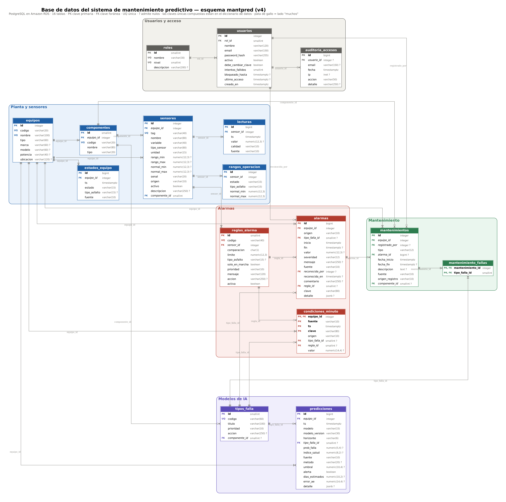

# Base de datos – Mantenimiento Predictivo QLA

Esquema PostgreSQL del sistema de mantenimiento predictivo del molino coloidal MC-01
(Química Latinoamericana S.A.). Alojado en **Amazon RDS** (`qla-mantpred`, us-east-2), esquema `mantpred`.

Responsable: Nicolás (Ingeniería de datos y backend)
Versión: 4.1 — basada en el esquema original de Franco Carvajal (v1/v2 en Supabase, migrado a RDS en v3)



- Diagrama en alta resolución: [`diagrama/bd_mantpred_v4.pdf`](diagrama/bd_mantpred_v4.pdf) · [`.svg`](diagrama/bd_mantpred_v4.svg)
- Descripción de cada tabla y columna: [`DICCIONARIO_DATOS.md`](DICCIONARIO_DATOS.md)

## Contenido

| Archivo | Qué es |
| --- | --- |
| `bd_mantpred_v4_1_completo.sql` | **Esquema final v4.1 en un solo archivo** (estructura + catálogos + bitácora, sin usuarios). Para crear una base nueva |
| `bd_mantenimiento_predictivo_v2.sql` | Esquema base (v2): tablas, seguridad (RLS) y datos iniciales |
| `migracion_v3.sql` | v3: reglas de alarma, condiciones por minuto, columnas de origen/fuente, 2 roles |
| `migracion_v4.sql` | v4: normalización final (ver abajo). Una sola transacción |
| `migracion_v4_1.sql` | v4.1: FK compuestas que aseguran que el equipo de un sensor o de una mantención coincida con el de su componente |
| `ejecutar_sql.py` | Ejecuta un archivo .sql contra RDS usando el archivo de conexión local |
| `crear_admin.py` | Crea el primer usuario administrador |
| `cargar_datos.py` | Carga una ventana del dataset simulado MC-01 en `lecturas` y `estados_equipo` |
| `requirements.txt` | Dependencias de los scripts |

**Base nueva (desde cero):** un solo archivo y luego el administrador:

```
python ejecutar_sql.py bd_mantpred_v4_1_completo.sql --env "$HOME\qla_rds.env"
python crear_admin.py --env "$HOME\qla_rds.env"
```

Equivale a aplicar `v2` → `migracion_v3.sql` → `migracion_v4.sql` → `migracion_v4_1.sql` (verificado: mismas tablas, columnas, restricciones, índices, comentarios, RLS y datos). Falla sin cambiar nada si el esquema `mantpred` ya existe.

**Base existente:** se aplican solo las migraciones que falten, en orden. Las migraciones quedan en el repositorio como historial de cómo evolucionó el esquema.

## Las 16 tablas, por área

- **Planta y sensores (6):** `equipos`, `componentes`, `sensores`, `lecturas`, `estados_equipo`, `rangos_operacion`
- **Modelos de IA (2):** `tipos_falla` (7 fallas + anomalía), `predicciones` (los 3 modelos)
- **Alarmas (3):** `reglas_alarma` (8 reglas fijas), `alarmas`, `condiciones_minuto`
- **Mantenimiento (2):** `mantenimientos`, `mantenimiento_fallas`
- **Usuarios y acceso (3):** `roles` (operador, administrador), `usuarios` (clave bcrypt), `auditoria_accesos`

## Qué cambió en v4 y por qué

| Cambio | Motivo |
| --- | --- |
| Nueva tabla `componentes` (11 tags de planta: TK-101, P-101, MC-01…) | El componente se guardaba como texto libre repetido en 4 tablas. Ahora es una FK: sin errores de tipeo y con integridad |
| `sensores`, `tipos_falla` y `mantenimientos` apuntan a `componentes` | Mismo motivo (3FN) |
| Nueva tabla `mantenimiento_fallas` (N:M) | Una preventiva atiende varias fallas a la vez; antes cabía solo una en `mantenimientos.tipo_falla_id` |
| Se eliminan `setpoints`, `lotes_produccion`, `tipos_emulsion` | Nunca se usaron: el dataset no trae lotes ni recetas |
| Se eliminan columnas sin uso (`canal_plc`, `vida_util_horas`, `alarmas.sensor_id`, `alarmas.setpoint_id`) | El sensor de una alarma se obtiene por su regla; las otras no las produce ningún proceso |
| Se eliminan las vistas `v_ultima_lectura`, `v_alarmas_activas` y la función antigua `purgar_lecturas_simuladas` | El backend no las usa; la limpieza queda en `purgar_datos_simulados(dias)` (de v3), que borra lo simulado antiguo de todas las series de tiempo |
| CHECK por modelo en `predicciones` | El predictivo exige falla; el autoencoder no tiene falla ni probabilidad; el diagnóstico no tiene error de reconstrucción |
| CHECK en `alarmas` (`origen` regla/modelo, coherencia regla ↔ origen) | Impide filas inconsistentes |
| `COMMENT` en todas las tablas y columnas clave | Documentación dentro de la propia base |
| (v4.1) FK compuesta `(componente_id, equipo_id)` en `sensores` y `mantenimientos` | `equipo_id` también se deduce del componente; la base garantiza que ambos coincidan (redundancia controlada, sin riesgo de contradicción) |

## Aplicar una migración en RDS

```
cd "Base de Datos"
python ejecutar_sql.py migracion_v4.sql --env "$HOME\qla_rds.env"
```

El archivo de conexión vive fuera del repositorio. Si algo falla, la transacción se revierte completa.

## Cómo se conecta cada parte

- **Simulador / IoT Core / Lambda:** la Lambda escribe la inferencia en DynamoDB; el backend la recoge y la guarda en `lecturas`, `estados_equipo`, `predicciones`, `condiciones_minuto` y `alarmas`.
- **Backend / web:** lee todo; gestiona `usuarios`, el reconocimiento de `alarmas` y los `mantenimientos`.

RLS activo y sin políticas: solo se accede con conexión directa desde el backend.

## Importante

- Los usuarios de prueba `@demo.qla.cl` se borran antes de la entrega final.
- Nunca subir al repositorio la contraseña de la base ni la cadena de conexión.

## Cargar datos simulados (opcional)

```
pip install -r requirements.txt
python cargar_datos.py --csv RUTA/Dataset_Molino_QLA_Realista.zip --dry-run
python cargar_datos.py --csv RUTA/Dataset_Molino_QLA_Realista.zip
```

- Es seguro repetirlo: lo ya cargado se omite. Otra ventana: `--inicio 2026-09-19 --dias 14`; `--reemplazar` borra lo simulado antes.
- La etiqueta de falla del dataset (`LABEL_Estado_Planta`) no se carga: en la planta real no existe.
- Las horas del dataset se interpretan como hora de Chile y se guardan en UTC.
