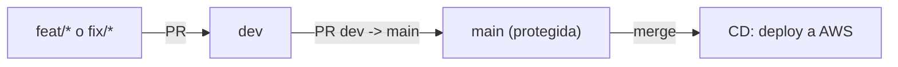

# CI/CD — Docker + GitHub Actions + AWS

## Flujo de ramas



| Evento | Workflow | Qué hace |
|---|---|---|
| PR hacia `dev` o `main`, push a `dev` | `ci.yml` | Lint (ruff), tests unitarios, build Docker y smoke test de las imágenes afectadas |
| Merge (push) a `main` | `cd.yml` | Build + push a ECR (tag = SHA), deploy Lambda y EC2, smoke test, rollback automático |
| Manual (Actions → CD → Run workflow) | `cd.yml` | Redeploy de `todo`, `backend` o `lambda` |

## Componentes

| Componente | Imagen ECR | Destino |
|---|---|---|
| Backend FastAPI + Dashboard web (`Backend/`, la web se sirve con `StaticFiles`) | `qla-backend` | EC2 `qla-servidor` (contenedor `qla`, puerto 80 → 8000) detrás de API Gateway `qla-dashboard` |
| Lambda de inferencia (`lambda_inferencia/`) | `qla-inferencia` | Lambda `qla-inferencia` |

## Configuración inicial (una sola vez)

1. **Rol OIDC en AWS** (con credenciales de administrador):
   ```bash
   cd "Fase 2/Evidencias Proyecto/Evidencia de sistema aplicacion/infraestructura_aws/cicd"
   EC2_ROLE=<rol-del-instance-profile-de-la-ec2> ./setup_github_oidc.sh
   ```
   Crea el proveedor `token.actions.githubusercontent.com`, el rol `github-actions-qla-deploy` (solo asumible desde `main` / environment `production` de este repo) con la política [`github_deploy_policy.json`](../Fase%202/Evidencias%20Proyecto/Evidencia%20de%20sistema%20aplicacion/infraestructura_aws/cicd/github_deploy_policy.json), y da al rol de la EC2 lectura en ECR + SSM.
2. **Variables del repo** (Settings → Secrets and variables → Actions → *Variables*):
   - `AWS_ROLE_ARN` = ARN impreso por el script
   - `AWS_REGION` = `us-east-1`
3. **Environment** `production` (Settings → Environments). Se crea solo en el primer deploy; ahí se puede añadir aprobación manual en el futuro.
4. **EC2**: debe tener el SSM Agent activo (Amazon Linux 2023 lo trae) y el archivo de secretos `/opt/qla/Backend/.env` (`DATABASE_URL`, `JWT_SECRET`, `CLAVE_INGESTA`). El primer deploy instala Docker y **desactiva el servicio systemd `qla`** (migración automática).

> No hay claves de AWS guardadas en GitHub: el workflow obtiene credenciales temporales (1 h) vía OIDC.

## Tests locales

```bash
# Backend
cd "Fase 2/Evidencias Proyecto/Evidencia de sistema aplicacion/Backend"
python -m venv .venv && . .venv/bin/activate
pip install -r requirements-dev.txt
ruff check app tests && pytest --cov=app

# Lambda (dentro de la imagen, igual que la CI)
cd ../lambda_inferencia
docker build -t qla-inferencia:local .
docker run --rm --entrypoint /bin/sh -v "$PWD/tests:/var/task/tests:ro" \
  -e AWS_REGION=us-east-1 -e AWS_ACCESS_KEY_ID=x -e AWS_SECRET_ACCESS_KEY=x \
  qla-inferencia:local -c "pip install -q pytest && cd /var/task && python -m pytest tests -q"

# Backend en Docker (modo demo, sin base de datos)
cd ../Backend
docker build -t qla-backend:local .
docker run --rm -p 8000:8000 -e MODO_DEMO=1 -e DEMO_CLAVE=ClaveDemo2026 \
  -e JWT_SECRET=$(openssl rand -hex 32) qla-backend:local
# http://localhost:8000  (usuario admin@demo.qla.cl / ClaveDemo2026)
```

## Rollback

- **Automático**: si `/api/salud` no responde tras el deploy en EC2, el script vuelve a la imagen anterior (`/opt/qla/imagen_actual`). Si la invocación de prueba de la Lambda falla, se restaura la `ImageUri` previa.
- **Manual**: revertir el commit en `main` (`git revert`) → el CD redepliega la versión anterior.

## Troubleshooting

| Síntoma | Causa probable |
|---|---|
| `Could not assume role with OIDC` | Falta `AWS_ROLE_ARN`, o el deploy no corre desde `main`/`production` |
| `No hay instancia EC2 en ejecución` | La EC2 `qla-servidor` está detenida |
| SSM `InvalidInstanceId` | SSM Agent inactivo o el rol de la EC2 sin `AmazonSSMManagedInstanceCore` |
| `docker pull` denegado en la EC2 | El rol de la EC2 no tiene `AmazonEC2ContainerRegistryReadOnly` |
| Healthcheck 503 | La API arrancó pero RDS/Supabase no responde (el deploy se acepta) |
| Lambda `InvalidParameterValueException` de imagen | La imagen se subió en formato OCI; el workflow usa `oci-mediatypes=false` |
