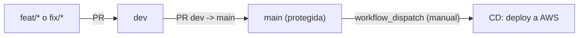

# CI/CD — Docker + GitHub Actions + AWS

## Flujo de ramas



| Evento | Workflow | Qué hace |
|---|---|---|
| PR hacia `dev` o `main`, push a `dev` | `ci.yml` | Lint (`ruff`, `shellcheck`), tests unitarios, build Docker y smoke test de los componentes afectados |
| Manual (Actions → CD (Despliegue Manual a AWS) → Run workflow) | `cd.yml` | Build + push a ECR (`SHA` y `latest`), aprovisiona/enciende EC2 + API Gateway, deploy vía SSM, test Lambda, rollback automático (`todo`, `backend` o `lambda`) |
| Manual (Actions → Control Servidor AWS → Run workflow) | `control_aws.yml` | Consulta `estado` o ejecuta `iniciar` / `detener` sobre EC2 (`qla-servidor`) y RDS (`qla-mantpred`) para ahorro de costos |

## Componentes

| Componente | Imagen ECR | Destino |
|---|---|---|
| Backend FastAPI + Dashboard web (`Backend/`, la web se sirve con `StaticFiles`) | `qla-backend` | EC2 `qla-servidor` (contenedor `qla`, puerto 80 → 8000) detrás de API Gateway `qla-dashboard` |
| Lambda de inferencia (`lambda_inferencia/`) | `qla-molino-inferencia` | Lambda `qla-molino-inferencia` |

## Configuración inicial (una sola vez)

1. **Rol OIDC / Usuario IAM en AWS** (con credenciales de administrador):
   ```bash
   cd "Fase 2/Evidencias Proyecto/Evidencia de sistema aplicacion/infraestructura_aws/cicd"
   ./setup_github_oidc.sh
   ```
   Crea el proveedor `token.actions.githubusercontent.com` y el rol `github-actions-qla-deploy` (asumible desde `main` o `environment: production`) con la política [`github_deploy_policy.json`](../Fase%202/Evidencias%20Proyecto/Evidencia%20de%20sistema%20aplicacion/infraestructura_aws/cicd/github_deploy_policy.json); si una SCP bloquea OIDC, crea como respaldo un usuario IAM con la misma política mínima.
2. **Variables y Secrets del repo** (Settings → Secrets and variables → Actions):
   - *Variables*: `AWS_REGION` = `us-east-2` y (si usa OIDC) `AWS_ROLE_ARN` = ARN impreso por el script.
   - *Secrets* (opcionales / según modo): `DATABASE_URL` (cadena PostgreSQL/RDS para desactivar `MODO_DEMO` automáticamente); si no usa OIDC, `AWS_ACCESS_KEY_ID` y `AWS_SECRET_ACCESS_KEY` (más `AWS_SESSION_TOKEN` si aplica).
3. **Environment** `production` (Settings → Environments). Ahí puede añadirse aprobación manual en el futuro.
4. **EC2**: `ensure_ec2_and_apigw.sh` crea automáticamente (si no existen) el rol `qla-ec2-role` con política de mínimo privilegio (`qla-ec2-app-policy`), la instancia `qla-servidor` (Amazon Linux 2023 + Docker + SSM Agent) y API Gateway `qla-dashboard`, y escribe `/opt/qla/Backend/.env` vía SSM sin exponer secretos en `user-data`. Al primer deploy por contenedor, `deploy_backend_ec2.sh` desactiva el servicio systemd `qla` si existiera.

> Cuando OIDC está activo no hay claves permanentes de AWS en GitHub: el workflow obtiene credenciales temporales (1 h).

## Tests locales

```bash
# Backend
cd "Fase 2/Evidencias Proyecto/Evidencia de sistema aplicacion/Backend"
python -m venv .venv && . .venv/bin/activate
pip install -r requirements-dev.txt
ruff check app tests && pytest --cov=app

# Lambda (dentro de la imagen, igual que la CI)
cd ../lambda_inferencia
docker build -t qla-molino-inferencia:local .
docker run --rm --entrypoint /bin/sh -v "$PWD/tests:/var/task/tests:ro" \
  -e AWS_REGION=us-east-2 -e AWS_ACCESS_KEY_ID=x -e AWS_SECRET_ACCESS_KEY=x \
  qla-molino-inferencia:local -c "pip install -q pytest && cd /var/task && python -m pytest tests -q"

# Backend en Docker (modo demo, sin base de datos)
cd ../Backend
docker build -t qla-backend:local .
docker run --rm -p 8000:8000 -e MODO_DEMO=1 -e DEMO_CLAVE=ClaveDemo2026 \
  -e JWT_SECRET=$(openssl rand -hex 32) qla-backend:local
# http://localhost:8000  (usuario admin@demo.qla.cl / ClaveDemo2026)
```

## Rollback

- **Automático**: si `/api/salud` no responde tras el deploy en EC2, `deploy_backend_ec2.sh` vuelve a la imagen anterior (`/opt/qla/imagen_actual`). Si la invocación de prueba de la Lambda falla, `cd.yml` restaura la `ImageUri` previa.
- **Manual**: revertir el commit en `main` (`git revert`) y volver a ejecutar manualmente el workflow `cd.yml` (`workflow_dispatch`).

## Troubleshooting

| Síntoma | Causa probable |
|---|---|
| `Could not assume role with OIDC` | Falta `AWS_ROLE_ARN`, o el deploy no corre desde `main`/`production` |
| `SSM Agent no alcanzó estado Online` | La EC2 recién arrancó o el rol `qla-ec2-role` no tiene `AmazonSSMManagedInstanceCore` |
| SSM `InvalidInstanceId` | SSM Agent inactivo o instancia detenida/en arranque |
| `docker pull` denegado en la EC2 | El rol de la EC2 no tiene `AmazonEC2ContainerRegistryReadOnly` |
| Healthcheck 503 | La API arrancó pero RDS no responde (`deploy_backend_ec2.sh` lo acepta localmente; el smoke test final de `cd.yml` espera HTTP 200) |
| Lambda `InvalidParameterValueException` de imagen | La imagen se subió en formato OCI; el workflow usa `oci-mediatypes=false` |
